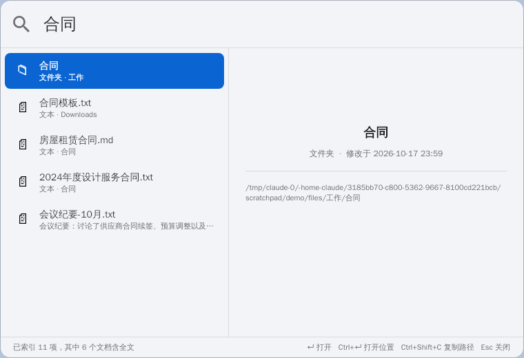
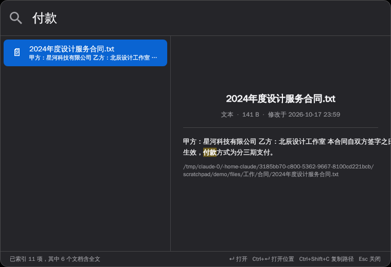
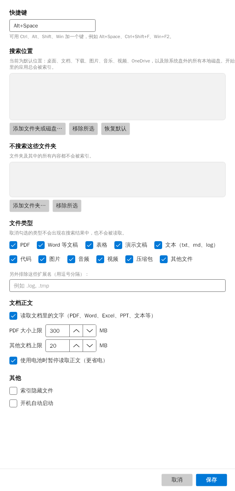

# 聚焦搜索 SpotlightWin — Spotlight for Windows

在 Windows 上使用的「聚焦搜索」：按 `Alt+Space` 唤起，输入关键词，立刻找到应用、文件、文件夹，以及 PDF、Word、Excel、PowerPoint、文本文件里的文字；右侧直接预览命中的那一页，回车打开并跳到该页。

**[⬇ 下载最新版](https://github.com/snowylove666-tech/spotlight-for-windows/releases/latest)**：推荐 `SpotlightWin-Setup-x.y.z.exe` 安装包（不需要管理员权限，带开始菜单、开机启动和卸载）；也可以下载单独的 `SpotlightWin.exe` 免安装直接运行。无需 .NET，Windows 10/11 x64。

> **English:** A macOS Spotlight–style launcher and desktop search for Windows. Press `Alt+Space` to instantly find apps, files and the text inside PDF / Word / PowerPoint documents (Chinese supported), preview the matching page with highlights, and open it right at that page. Fully local and private; a single portable exe built with C# / .NET 10, Avalonia and SQLite FTS5.





- 毫秒级搜索：本地 SQLite 全文索引，近 10 万个文件时查询仍在 30 毫秒内
- 低能耗：后台线程使用 Windows 后台模式和 EcoQoS，只做增量更新，用电池时暂停读取正文；隐藏后自动释放内存
- 中文友好：中文二元分词，任意中文片段都能搜到；自动识别 UTF-8 / UTF-16 / GBK 编码
- 越用越准：记住你对每个输入选了哪个结果，并参考打开频率和时间
- 所见即原件：PDF 显示命中的那一页并标黄关键词，可翻页（`Ctrl+←/→` 或滚轮）；PDF、表格、文本都能用 `Ctrl+↑/↓` 在文件内的命中之间跳转，上方显示共找到多少项、文件内有多少处命中；Word / PPT 用 Windows 资源管理器同款预览器显示原样；Excel / WPS 表格直接显示命中所在工作表的单元格并标出命中格；文本和代码显示命中位置的原文；图片显示原图
- 自带计算器：输入 `1280*0.85` 直接出结果

设计细节见 [docs/DESIGN.md](docs/DESIGN.md)。

## 安装与使用

1. 把 `SpotlightWin.exe` 放到任意文件夹（例如 `C:\Tools\SpotlightWin\`），双击运行。不需要安装 .NET。
2. 首次运行会弹出搜索窗口，同时在后台建立索引，托盘区出现放大镜图标。索引进度显示在窗口底部。
3. 之后随时按 `Alt+Space` 唤起。托盘图标右键 →「设置…」可以修改快捷键、搜索位置、排除的文件夹和文件类型、开机自动启动。
4. 某个文件搜不到时，托盘右键 →「检查某个文件为什么搜不到…」，选中文件即可看到原因（不在搜索位置、超过大小上限、正文还在排队等）。

> Windows SmartScreen 可能提示「未知发布者」，因为 exe 没有代码签名。点「更多信息 → 仍要运行」即可。

| 按键 | 作用 |
| --- | --- |
| `Alt+Space` | 唤起 / 隐藏 |
| `↑` `↓` | 选择结果 |
| `Tab` / `Shift+Tab` | 切换结果类型筛选（全部、应用、文件夹、PDF、文稿、表格、演示、图片、音视频、文本代码、其他）；右侧可按相关、日期、名称、大小、格式排序，再点一次反转顺序 |
| `Ctrl+←` `Ctrl+→` | PDF 预览上一页、下一页；滚轮滚过页底也会翻页 |
| `Ctrl+↑` `Ctrl+↓` | 预览中跳到文件内的上一处、下一处命中（PDF、表格、文本） |
| `Enter` | 打开（计算结果则复制）。按正文搜到的 PDF 直接跳到命中页（SumatraPDF / Acrobat 还会自动搜索该词；Edge / Chrome 跳到页）；文本文件在 Notepad++ / VS Code 中跳到所在行 |
| `Ctrl+Enter` | 在资源管理器中显示 |
| `Ctrl+Shift+C` | 复制路径 |
| `Esc` | 清空输入，再按一次关闭 |

默认搜索位置：桌面、文档、下载、图片、音乐、视频、OneDrive，以及除系统盘外的所有本地磁盘（包括百度网盘同步盘、OneDrive 这类云同步文件夹；“仅在线”的云文件只收录文件名）。设置保存在 `%AppData%\SpotlightWin\settings.json`。索引文件 `index.db` 默认放在剩余空间最大的非系统盘（例如 `D:\SpotlightWinData`），可在设置「索引位置」中更改；删掉后会自动重建。默认读取 PDF、Word、Excel（xlsx / xls / csv / WPS 表格，每个表格最多前 30 万字）、PPT 和文本/Markdown 的正文，日志、代码等只收录文件名（设置「读取正文的文件类型」可改）。想搜得更全可以在设置里打开「完整正文索引」：所有类型、所有文件夹都读取正文，索引会大很多。

不在开始菜单里的绿色软件、自己开发的程序（例如 `D:\工具\lightodo\dist\Lightodo.exe`），只要 exe 和所在文件夹同名，也会作为「应用」出现。

## 从源码构建

需要 [.NET 10 SDK](https://dotnet.microsoft.com/download/dotnet/10.0)。在 PowerShell 中：

```powershell
# 运行测试
dotnet test

# 直接运行（调试）
dotnet run --project src/Spotlight.App

# 打包安装包（需要 Inno Setup 6，输出到 artifacts\installer\）
powershell -ExecutionPolicy Bypass -File installer\build.ps1

# 打包成单个 exe（输出到 artifacts\win-x64\SpotlightWin.exe）
dotnet publish src/Spotlight.App -c Release -r win-x64 -o artifacts/win-x64
```

ARM 版 Windows 设备把 `win-x64` 换成 `win-arm64`。项目在 Linux/macOS 上同样可以编译和跑测试，并能交叉打包 Windows 版。

命令行工具（和桌面版使用同一个引擎）：

```powershell
dotnet run --project src/Spotlight.Cli -- index D:\资料 --db test.db
dotnet run --project src/Spotlight.Cli -- search 合同 --db test.db
dotnet run --project src/Spotlight.Cli -- check D:\资料\某文件.pdf --db test.db
```

## 项目结构

```
src/Spotlight.Core     跨平台核心：分词、索引、内容提取、搜索排序
src/Spotlight.App      Windows 界面：搜索窗口、全局热键、托盘、系统图标
src/Spotlight.Cli      命令行版
tests/                 单元测试和端到端测试
tools/Screenshot       离屏渲染界面截图
tools/make_icon.py     生成应用图标
docs/DESIGN.md         设计文档
```
